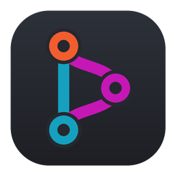
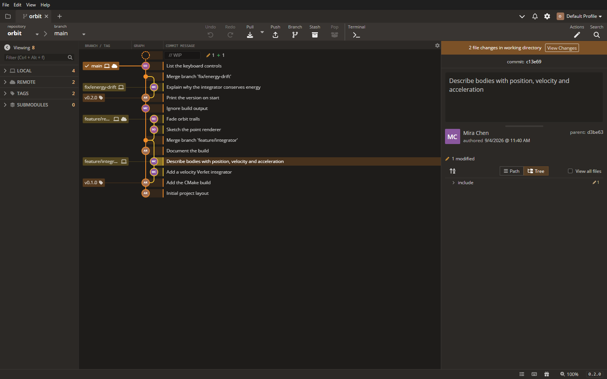
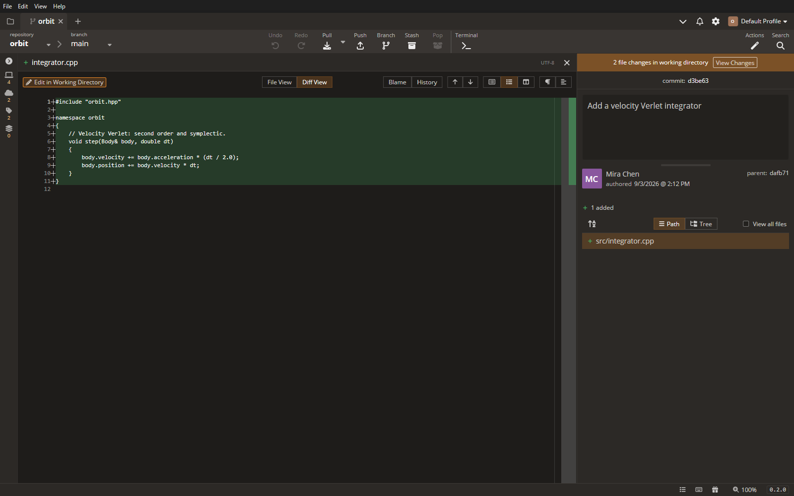
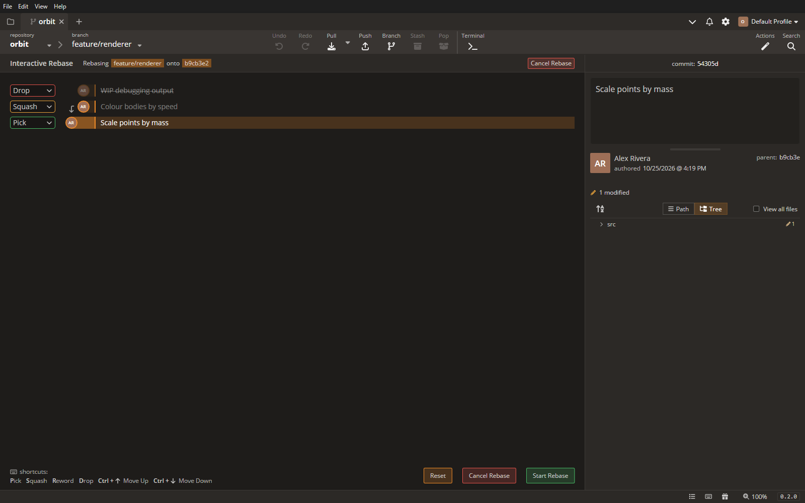
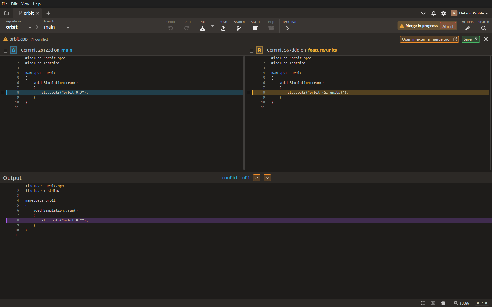
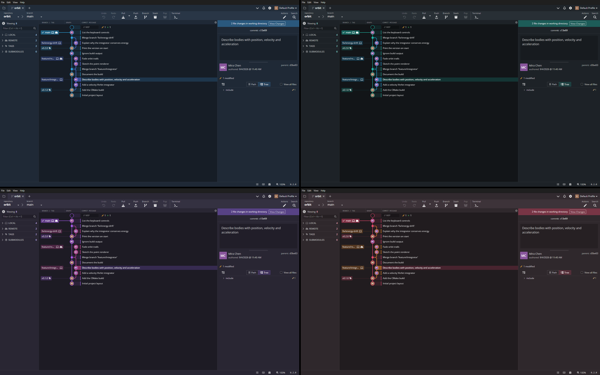

<div align="center">



# ImGit Desktop

**A fast, native Git client with a commit graph front and centre.**
C++23 on Dear ImGui and libgit2 · Windows, Linux and macOS

[](https://github.com/alt-orange/ImGit/releases/latest)
[](https://github.com/alt-orange/ImGit/releases)

[](https://github.com/alt-orange/ImGit/actions/workflows/ci.yml)


[](https://discord.gg/eDgdaWbqwZ)
[](https://t.me/orangennotes)

<br>

---

**[<kbd> <br> &nbsp;Download&nbsp; <br> &nbsp;</kbd>][DOWNLOAD]** 
**[<kbd> <br> &nbsp;Install&nbsp; <br> &nbsp;</kbd>][INSTALL]** 
**[<kbd> <br> &nbsp;Porting&nbsp; <br> &nbsp;</kbd>][PORTING]** 
**[<kbd> <br> &nbsp;Contribute&nbsp; <br> &nbsp;</kbd>][CONTRIBUTING]** 
**[<kbd> <br> &nbsp;Donate&nbsp; <br> &nbsp;</kbd>][SPONSOR]** 

---

<br>

</div>



## Highlights

- **Commit graph** — lanes, merge and stash nodes, branch / tag / remote labels with ahead and behind counts, search
  (`Ctrl+F`; `Cmd` stands in for `Ctrl` on macOS throughout), multi-select, lazy loading and drag-and-drop of
  branches to merge, rebase or reset.
- **Stage and commit** — per-file and per-folder staging, a tree or path view with change counts, amend, push after
  commit, and undo / redo (`Ctrl+Z` / `Ctrl+Y`) for almost every operation.
- **Interactive rebase** — pick, reword, squash, drop and reorder in a full view, from the keyboard or the mouse.
- **Merge tool** — resolve conflicts three ways: take a side, take single lines, or edit the result by hand.
- **Built in** — a real terminal (PowerShell on Windows, your login shell elsewhere), a command palette (`Ctrl+P`),
  profiles with their own settings and commit author, and a sign-in prompt for HTTPS remotes.
- **Themes** — six dark themes, orange-accented ImGit Dark by default.

## Tour

### Commits and diffs

Click a commit for its message, author, parents and changed files; click a file for its diff, inline or side by side,
with the whole file or just the hunks. The working directory's changes stage and unstage from the same panel.



### File history and blame

*History* in a file's toolbar (or *File History* in its menu) lists every commit that changed the file, renames
followed, with the file as the selected commit left it or that commit's diff next to it. The gutter blames each line
with its author's avatar and a bar in the commit's colour; *Blame* adds the commit and date to every run of lines,
and clicking a run selects its commit.

### Interactive rebase

Right-click a commit and choose *Interactive Rebase*: every commit above it becomes a row. `P` / `S` / `R` / `D` set the
selected row's action, `Ctrl+↑` / `Ctrl+↓` move it, and Reword opens a message editor in place. Start Rebase rewrites
the branch; a conflict rolls everything back, and Undo restores the old head.



### Merge conflicts

Clicking a conflicted file opens the merge tool: your side (**A**) and theirs (**B**) next to each other, the result
under them. Tick a conflict to take a side, click single lines to take just those, step through the conflicts with
the arrows, or double-click the output to edit it. Save writes the file and marks it resolved.



### Themes

ImGit Dark, Ocean, Midnight Teal, Amethyst, Rose and Claude Code (the greys, text and terracotta accent of Claude Code
Desktop's dark theme): pick one in Preferences → UI Customization or with `Ctrl+P` → *Switch Theme*. The graph's lanes
start at each theme's accent colour.



## Everything else

- **Toolbar** — repository and branch switchers, Undo / Redo, Pull (fast-forward, fast-forward only, rebase, fetch
  all), Push (asks for an upstream when there is none), Branch, Stash, Pop, Terminal, Git LFS and the command palette.
- **Context menus** — checkout, branches and tags, cherry-pick, revert, reset, edit any commit message on the branch,
  squash / drop selected commits, merge, rebase, set upstream, hide / solo / pin branches, push and delete remote refs,
  stashes, patches, copy sha / message / names.
- **Left panel** — local branches as a folder tree, remotes, tags, stashes, worktrees and submodules, with a filter.
- **Profiles** — each profile keeps its own settings, tabs, repository lists and commit author, and shows its author's
  Gravatar or initials. Settings live in `%APPDATA%\.imgit` (`~/.imgit` elsewhere).
- **Credentials** — when a push, pull, fetch or clone needs a username and password, ImGit asks in a sign-in bar and
  runs the command again. Accepted credentials last for the session; *Remember me* hands them to your git credential
  helper.
- **Repository Management** — favourites, recent and open repositories with their branch, ahead / behind and
  uncommitted changes.

Local operations use libgit2. Network operations (fetch, pull, push, clone, rebase, remote refs, LFS) run the `git`
on your `PATH` in the background, so your credential helpers and SSH setup apply as usual.

## Building

**Windows** — Visual Studio 2022 or later with the C++ workload, clang-cl, CMake and vcpkg (the ones bundled with
Visual Studio work), and `git` on `PATH`:

```bash
cmake --preset x64-release
cmake --build --preset x64-release
build/x64-release/imgit.exe path/to/repository
```

`CMakePresets.json` points `CMAKE_TOOLCHAIN_FILE` at the Visual Studio vcpkg bundle; change it (or use
`$env{VCPKG_ROOT}/scripts/buildsystems/vcpkg.cmake`) for another install. Dependencies come from `vcpkg.json`: imgui
with the GLFW / OpenGL 3 bindings, glfw3, libgit2, cpr, nativefiledialog-extended and stb. Use `x64-debug` for a build
with a console for logs.

**Linux** — g++ 13+ or clang 17+, CMake, Ninja, a vcpkg checkout in `VCPKG_ROOT`, and GLFW's X11 packages
(`libxinerama-dev libxcursor-dev xorg-dev libglu1-mesa-dev pkg-config`):

```bash
cmake --preset linux-release
cmake --build --preset linux-release
build/linux-release/imgit path/to/repository
```

File dialogs need the xdg desktop portal (`xdg-desktop-portal` and a backend such as `xdg-desktop-portal-gtk`).
`vcpkg-overlays/dbus` is the stock dbus port without its systemd default. See `PORTING.md` for what each platform
implements.

**macOS** — Xcode (or the Command Line Tools) 15+, CMake, Ninja and a vcpkg checkout in `VCPKG_ROOT` (`brew install
cmake ninja pkg-config autoconf automake libtool`):

```bash
cmake --preset macos-release
cmake --build --preset macos-release
build/macos-release/ImGit.app/Contents/MacOS/ImGit path/to/repository   # or open build/macos-release/ImGit.app
```

The build is an app bundle, `ImGit.app`, with the Dock icon (`res/imgit.icns`), the traffic lights in the tabs bar
(no separate title bar; drag the bar's empty part to move the window) and the File / Edit / View / Help menus in
the system menu bar. vcpkg picks
`arm64-osx` on Apple silicon and `x64-osx` on Intel; `vcpkg-triplets/` holds both with the deployment target
(macOS 12, the same as `CMAKE_OSX_DEPLOYMENT_TARGET` in `CMakeLists.txt`). Shortcuts use `Cmd` where the labels
say `Ctrl`, and `Option` for `Alt`; in the terminal panel the Control key still sends control sequences. A
downloaded `ImGit.app` is only ad-hoc signed, so the first launch needs a right-click → *Open* (or
`xattr -d com.apple.quarantine ImGit.app`).

**CI and releases** — `.github/workflows/ci.yml` builds Windows, Linux and macOS on every push to `github-main` and
every pull request (the `ci-windows` / `ci-linux` / `ci-macos` presets, vcpkg at the manifest's baseline, its binary
cache in the Actions cache) and takes a screenshot as a smoke test under Xvfb on Linux and, best effort, on the macOS
runner. Publishing a GitHub release runs `release.yml`, which attaches `imgit-<tag>-windows-x64.zip`,
`imgit-<tag>-linux-x64.tar.gz`, `imgit-<tag>-macos-arm64.zip` (the ad-hoc signed `ImGit.app`) and `SHA256SUMS.txt`
to it; run it by hand with a tag to rebuild an existing release's packages. The release executables for Windows and
Linux are compressed with UPX (macOS has no working UPX target); some antivirus scanners flag UPX-packed files, and
`upx -d` restores the original binary.

**Warnings** — the build treats every warning as an error on every platform (`/W4 /WX` on MSVC and clang-cl,
`-Wall -Wextra -Wpedantic -Werror` elsewhere), so a new warning fails the build rather than piling up.

**Headless screenshots** — `imgit <repo> --screenshot out.bmp [--size WxH] [--select-row N]` renders a few frames and
exits; `--script steps.txt --shots dir` replays clicks and keys and saves shots along the way. The images above were
made this way.

## Source map

| Path | What |
|---|---|
| `src/git/` | the libgit2 wrapper (history, refs, status, diffs, index, branches, tags, remotes, stashes, merge, history rewriting, conflict sides) and the `git` command runner with the sign-in prompt's askpass side |
| `src/graph/` | lane and edge assignment for the commit graph |
| `src/app/` | the application: settings, profiles, tabs, themes, repository state, undo, the merge model, toasts, the terminal's screen |
| `src/ui/` | every view: graph, panels, diff, interactive rebase, merge tool, menus, dialogs, preferences, command palette, terminal |
| `src/platform/` | everything that differs per OS: processes, pseudo console, shell actions and dialogs, system facts, the window (`window_mac.mm` for the Cocoa calls) |
| `src/gfx/` | image decoding, the LCD text renderer and the platform font loader |
| `assets/` | fonts, icons and images compiled into the executable |
| `res/` | the Windows icon and resource script, the macOS `.icns` and `Info.plist` template |
| `tools/app_icon.py` | draws the app icon (`app_icon.png`, `imgit.ico`, `imgit.icns`) |

## Credits

ImGit is built on [Dear ImGui](https://github.com/ocornut/imgui) (MIT), [libgit2](https://libgit2.org) (GPLv2 with
linking exception), [GLFW](https://www.glfw.org) (zlib), [cpr](https://github.com/libcpr/cpr) (MIT),
[nativefiledialog-extended](https://github.com/btzy/nativefiledialog-extended) (zlib) and
[stb](https://github.com/nothings/stb) (public domain). It ships the Open Sans font (SIL OFL,
`assets/fonts/LICENSE.txt`), Font Awesome Free icons (CC BY 4.0, `assets/icons/NOTICE.txt`) and two of Chromium's
cursors (BSD, `assets/cursors/NOTICE.txt`).

<!-- Link references -->

[DOWNLOAD]: https://github.com/alt-orange/ImGit/releases
[INSTALL]: INSTALL.md
[PORTING]: PORTING.md
[CONTRIBUTING]: CONTRIBUTING.md
[SPONSOR]: https://boosty.to/orangecpp/purchase/3568644?ssource=DIRECT&share=subscription_link
