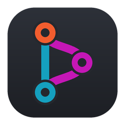
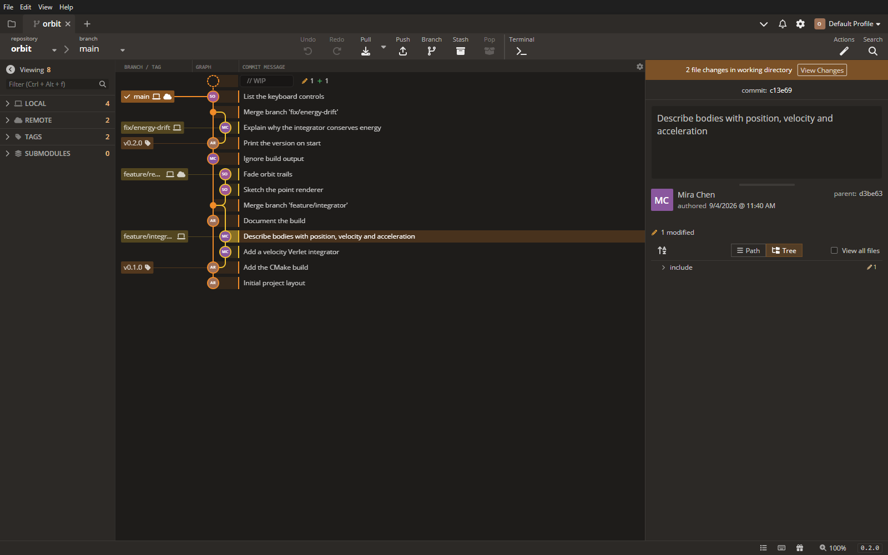
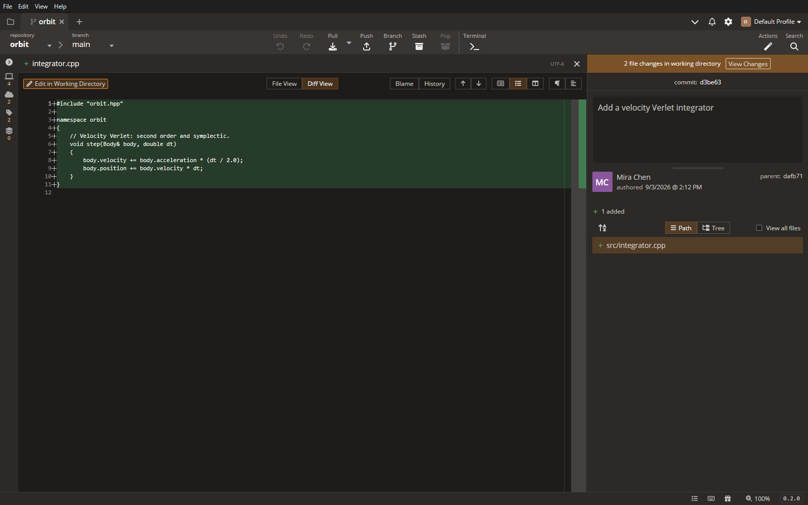
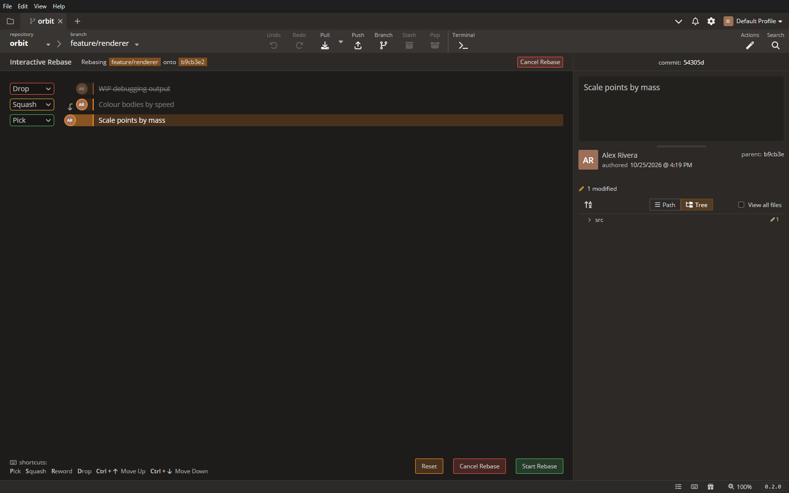
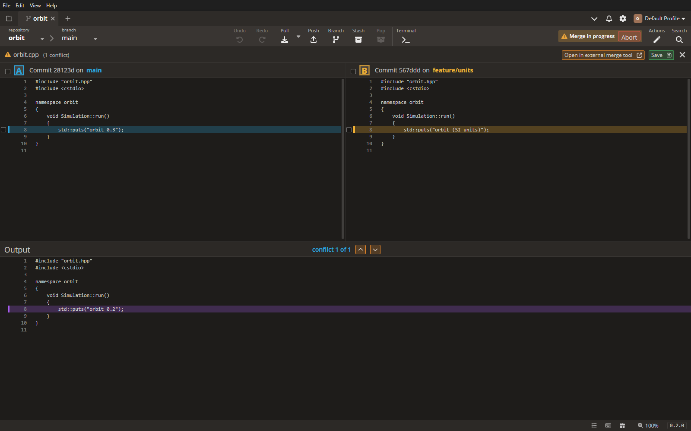
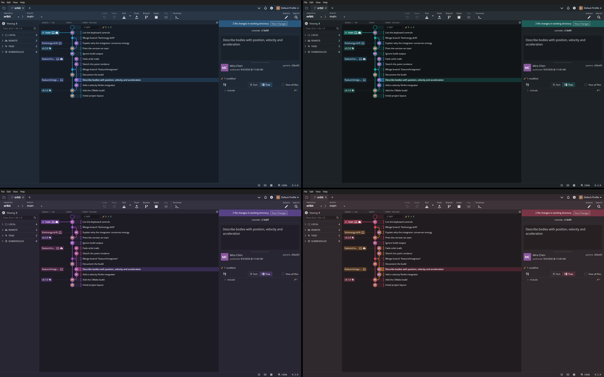

<div align="center">



# ImGit Desktop

**A fast, native Git client with a commit graph front and centre.**
Rust on Dear ImGui and libgit2 · Windows, Linux and macOS

[](https://github.com/alt-orange/ImGit/releases/latest)
[](https://github.com/alt-orange/ImGit/releases)

[](https://github.com/alt-orange/ImGit/actions/workflows/ci.yml)


[](https://discord.gg/eDgdaWbqwZ)
[](https://t.me/orangennotes)

<br>

---

**[<kbd> <br> &nbsp;Download&nbsp; <br> &nbsp;</kbd>][DOWNLOAD]** 
**[<kbd> <br> &nbsp;Install&nbsp; <br> &nbsp;</kbd>][INSTALL]** 
**[<kbd> <br> &nbsp;Contribute&nbsp; <br> &nbsp;</kbd>][CONTRIBUTING]** 
**[<kbd> <br> &nbsp;Donate&nbsp; <br> &nbsp;</kbd>][SPONSOR]** 

---

<br>

</div>



## Highlights

- **Commit graph** — lanes, merge and stash nodes, branch / tag / remote labels with ahead and behind counts, search
  (`Ctrl+F`; `Cmd` stands in for `Ctrl` on macOS throughout), multi-select, lazy loading and drag-and-drop of
  branches to merge, rebase or reset.
- **Stage and commit** — per-file and per-folder staging, a tree or path view with change counts, amend, push after
  commit, and undo / redo (`Ctrl+Z` / `Ctrl+Y`) for almost every operation.
- **Interactive rebase** — pick, reword, squash, drop and reorder in a full view, from the keyboard or the mouse.
- **Merge tool** — resolve conflicts three ways: take a side, take single lines, or edit the result by hand.
- **Built in** — a real terminal (PowerShell on Windows, your login shell elsewhere), a command palette (`Ctrl+P`),
  profiles with their own settings and commit author, and a sign-in prompt for HTTPS remotes.
- **Themes** — six dark themes, orange-accented ImGit Dark by default.

## Tour

### Commits and diffs

Click a commit for its message, author, parents and changed files; click a file for its diff, inline or side by side,
with the whole file or just the hunks. The working directory's changes stage and unstage from the same panel.



### File history and blame

*History* in a file's toolbar (or *File History* in its menu) lists every commit that changed the file, renames
followed, with the file as the selected commit left it or that commit's diff next to it. The gutter blames each line
with its author's avatar and a bar in the commit's colour; *Blame* adds the commit and date to every run of lines,
and clicking a run selects its commit.

### Interactive rebase

Right-click a commit and choose *Interactive Rebase*: every commit above it becomes a row. `P` / `S` / `R` / `D` set the
selected row's action, `Ctrl+↑` / `Ctrl+↓` move it, and Reword opens a message editor in place. Start Rebase rewrites
the branch; a conflict rolls everything back, and Undo restores the old head.



### Merge conflicts

Clicking a conflicted file opens the merge tool: your side (**A**) and theirs (**B**) next to each other, the result
under them. Tick a conflict to take a side, click single lines to take just those, step through the conflicts with
the arrows, or double-click the output to edit it. Save writes the file and marks it resolved.



### Themes

ImGit Dark, Ocean, Midnight Teal, Amethyst, Rose and Claude Code (the greys, text and terracotta accent of Claude Code
Desktop's dark theme): pick one in Preferences → UI Customization or with `Ctrl+P` → *Switch Theme*. The graph's lanes
start at each theme's accent colour.



## Everything else

- **Toolbar** — repository and branch switchers, Undo / Redo, Pull (fast-forward, fast-forward only, rebase, fetch
  all), Push (asks for an upstream when there is none), Branch, Stash, Pop, Terminal, Git LFS and the command palette.
- **Context menus** — checkout, branches and tags, cherry-pick, revert, reset, edit any commit message on the branch,
  squash / drop selected commits, merge, rebase, set upstream, hide / solo / pin branches, push and delete remote refs,
  stashes, patches, copy sha / message / names.
- **Left panel** — local branches as a folder tree, remotes, tags, stashes, worktrees and submodules, with a filter.
- **Profiles** — each profile keeps its own settings, tabs, repository lists and commit author, and shows its author's
  Gravatar or initials. Settings live in `%APPDATA%\.imgit` (`~/.imgit` elsewhere).
- **Credentials** — when a push, pull, fetch or clone needs a username and password, ImGit asks in a sign-in bar and
  runs the command again. Accepted credentials last for the session; *Remember me* hands them to your git credential
  helper.
- **Repository Management** — favourites, recent and open repositories with their branch, ahead / behind and
  uncommitted changes.

Local operations use libgit2. Network operations (fetch, pull, push, clone, rebase, remote refs, LFS) run the `git`
on your `PATH` in the background, so your credential helpers and SSH setup apply as usual.

## Building

ImGit is a Cargo workspace. You need a stable Rust toolchain (1.90 or later), a C and C++ compiler for the two
bundled C libraries (libgit2 and Dear ImGui are built from source by their crates), and `git` on `PATH`:

```bash
cargo build --release -p imgit
target/release/imgit path/to/repository
```

The release profile is fully optimised, carries no debug info and aborts on a panic. `cargo xtask release` does the
same build and then packs the executable in place with [UPX](https://upx.github.io) (which must be on `PATH`).

A debug build (`cargo build -p imgit`) keeps a console for logs. `cargo test --workspace` runs the tests and
`cargo clippy --workspace --all-targets` the lints; both are expected to stay clean.

**Windows** — the MSVC toolchain (Visual Studio 2022 or later with the C++ workload). This is the platform the Rust
build is developed and tested on.

**Linux and macOS** — the Rust code type-checks for `x86_64-unknown-linux-gnu` and `aarch64-apple-darwin`, but these
builds have not been linked or run yet. Linux needs the usual X11 / Wayland and OpenSSL development packages
(`pkg-config libssl-dev`), and file dialogs need the xdg desktop portal. On macOS the app bundle, the native menu bar
and the title-bar integration are not ported yet.

**CI and releases** — `.github/workflows/ci.yml` builds and tests on Windows, Linux and macOS on every push to
`github-main` and every pull request, and takes a screenshot as a smoke test under Xvfb on Linux. Publishing a GitHub
release runs `release.yml`, which attaches the packages and `SHA256SUMS.txt` to it. The release executables for
Windows and Linux are compressed with UPX; some antivirus scanners flag UPX-packed files, and `upx -d` restores the
original binary.

**Headless screenshots** — `imgit <repo> --screenshot out.bmp [--size WxH] [--select-row N]` renders a few frames and
exits; `--script steps.txt --shots dir` replays clicks and keys and saves shots along the way. The images above were
made this way.

## Source map

| Path | What |
|---|---|
| `crates/imgit-git/` | the libgit2 layer on `git2` (history, refs, status, diffs, index, branches, tags, remotes, stashes, merge, history rewriting, conflict sides), the `git` command runner with the sign-in prompt's askpass side, and lane and edge assignment for the commit graph |
| `crates/imgit-app/` | the logic that needs no UI: preferences, profiles, theme files, workflows, connections, the merge model, each tab's repository state and undo |
| `crates/imgit-syntax/` | the syntax highlighter |
| `crates/imgit-vt/` | the terminal's screen model |
| `crates/imgit-platform/` | everything that differs per OS outside the window: processes, pseudo console, shell actions and dialogs, system facts |
| `crates/imgit/` | the application: the window and event loop, image decoding, the LCD text renderer and the platform font loader (`gfx/`), the theme, settings, tabs and toasts (`app/`), and every view (`ui/`): graph, panels, diff, interactive rebase, merge tool, menus, dialogs, preferences, command palette, terminal |
| `assets/` | fonts, icons and images compiled into the executable |
| `res/` | the Windows icon and the macOS `.icns` |
| `tools/app_icon.py` | draws the app icon (`app_icon.png`, `imgit.ico`, `imgit.icns`) |

## Credits

ImGit is built on [Dear ImGui](https://github.com/ocornut/imgui) (MIT) through
[dear-imgui-rs](https://github.com/Latias94/dear-imgui-rs), [libgit2](https://libgit2.org) (GPLv2 with linking
exception) through [git2](https://github.com/rust-lang/git2-rs), [winit](https://github.com/rust-windowing/winit),
[glutin](https://github.com/rust-windowing/glutin) and [glow](https://github.com/grovesNL/glow), and the other crates
listed in `Cargo.lock`. It ships the Open Sans font (SIL OFL, `assets/fonts/LICENSE.txt`), Font Awesome Free icons
(CC BY 4.0, `assets/icons/NOTICE.txt`) and two of Chromium's cursors (BSD, `assets/cursors/NOTICE.txt`).

<!-- Link references -->

[DOWNLOAD]: https://github.com/alt-orange/ImGit/releases
[INSTALL]: INSTALL.md
[CONTRIBUTING]: CONTRIBUTING.md
[SPONSOR]: https://boosty.to/orangecpp/purchase/3568644?ssource=DIRECT&share=subscription_link
